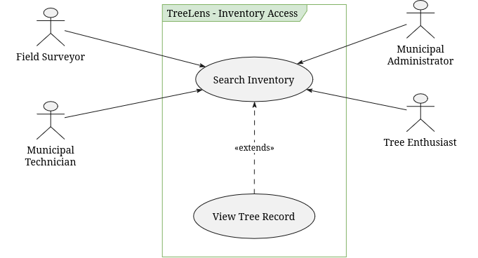
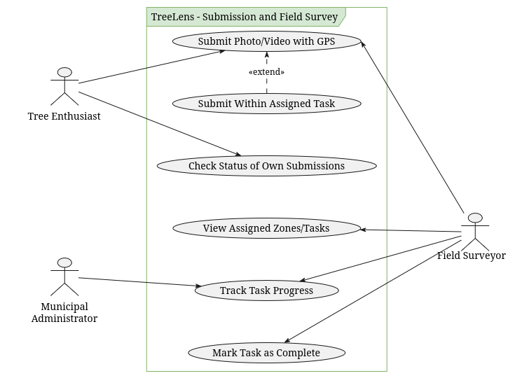
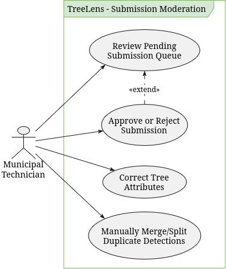
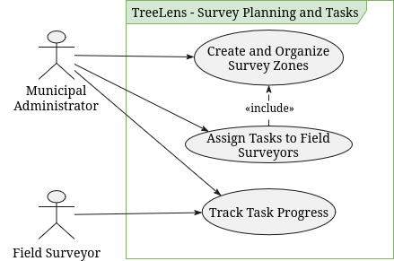
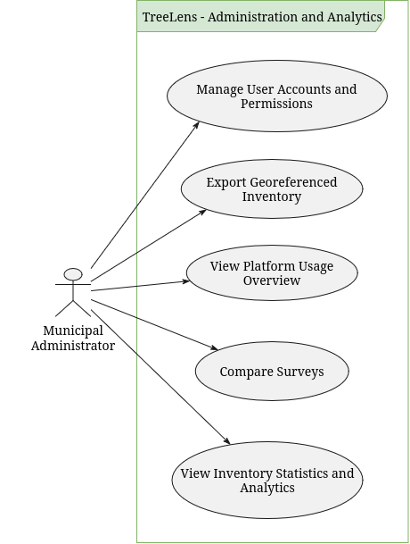
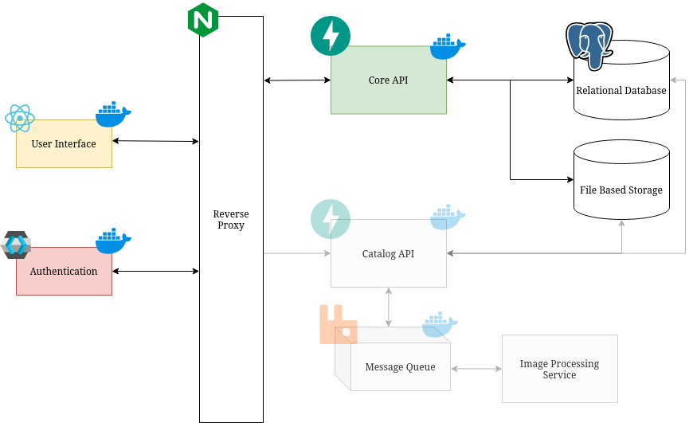
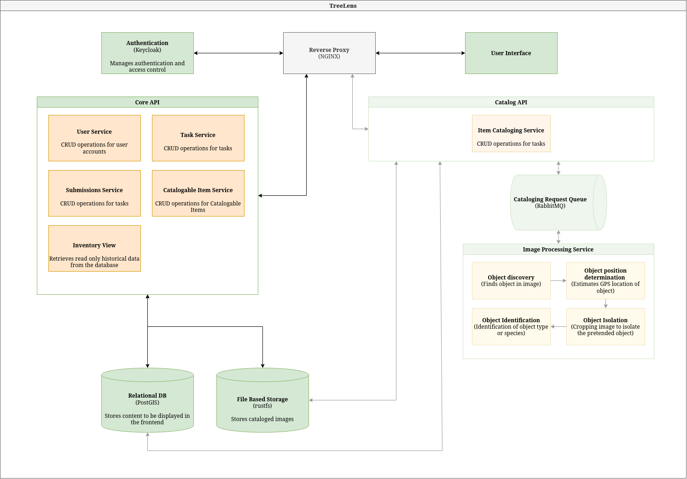

import PresentationViewer from '~/components/PresentationViewer.astro';

<PresentationViewer src="/documentation-website/presentations/ms2.pdf" title="MS2" />

---

## Table of Contents

1. [State of the Art](#1-state-of-the-art)
2. [Actors](#2-actors)
3. [Functional Requirements](#3-functional-requirements)
4. [Non-Functional Requirements](#4-non-functional-requirements)
5. [Use Cases](#5-use-cases)
6. [User Stories](#6-user-stories)
7. [Container-Level Architecture](#7-container-level-architecture)
8. [Components-Level Architecture](#8-components-level-architecture)
9. [Mock-ups](#9-mock-ups)

---

## 1. State of the Art
### 1.1. Manual and semi-automated municipal practice
Municipal tree inventorying is still largely a manual process. Even the tools built specifically to support this work assume the data collection happens on foot: standard protocols like i-Tree Streets have staff walk selected street segments and record every tree along them by hand, relying on sampling rather than a full census precisely because visiting every single tree is considered too costly. i-Tree Eco and Streets are valuable once data exists, turning an inventory into reports on carbon sequestration, stormwater value, or air quality, but they analyze data that has already been collected manually. They do not collect it themselves, and they offer no way to keep that data current without repeating the same manual effort.

### 1.2. Collaborative inventory platforms
A second generation of tools tries to distribute this manual effort across many people instead of a single survey team.

**OpenTreeMap** lets municipalities, organizations, and residents jointly maintain a shared tree map: adding, editing, and photographing trees collaboratively, with ecosystem benefits calculated automatically once the data is in. This genuinely improves accessibility and participation, but every tree still has to be found, measured, and entered by a person standing in front of it. The platform organizes manual data entry; it does not replace it.

**iNaturalist** goes a step further by using computer vision to suggest a species once a photo is uploaded, which the community then confirms. This is the closest any mainstream tool gets to what TreeLens does for detection. But the gap that matters is structural, not technical: an iNaturalist observation only exists because someone happened to be there and chose to photograph that specific tree. There is no systematic sweep of a defined zone, and critically, no way to know which trees in that zone have not been seen yet. Coverage depends entirely on where enthusiasts happen to walk, which means the inventory it produces is inherently incomplete and biased toward whatever areas are popular to visit.

### 1.3. Research pipelines for automated tree mapping
Academic work shows that detecting and locating trees automatically from street-level imagery is technically achievable. Pipelines built on Google Street View and aerial imagery can detect trees across multiple views of the same location, combine those detections to avoid double-counting, recognize species, and even track changes over time by comparing imagery from different dates. More recent work has released large public datasets joining city tree records with Street View and aerial imagery specifically to push this kind of automated monitoring forward as a serious research direction.

The problem is that none of this ever becomes software a municipality can actually run. These projects stop at the research stage: a dataset, a model, and a set of offline results published in a paper. There is no interactive map for a technician to browse, no workflow for reviewing and correcting what the model got wrong, no way to assign survey zones to a team, no handling of the personal data (faces, license plates) that inevitably appears in street-level imagery, and no mechanism for human corrections to ever feed back into the model. They prove the idea works; they do not deliver a tool anyone outside a research lab can use.

### 1.4. The gap in the market
Put together, this leaves municipalities with a real and unresolved choice between two unsatisfying options. Either they use something ready to deploy today and accept that it will always depend on someone physically visiting, photographing, or confirming every tree by hand, or they look at what automated detection can do in research papers, and accept that none of it exists as a product they could actually log into and operate. There is currently no tool that is simultaneously automatic and genuinely ready for municipal use. Municipalities are left to either keep paying for manual labor indefinitely, or wait for research to eventually turn into product, something that, so far, has not happened in this space.

### 1.5. Where TreeLens fits
TreeLens is built to close exactly that gap. It brings together what research pipelines have shown is possible, automatic detection and geolocation from street-level imagery, with no need to visit each tree, with what municipal and collaborative platforms already get right: a usable interface, a validation workflow a technician can actually work with day to day, and a way to organize survey effort across a team.

Three things set it apart from everything reviewed above, together:
- **A validation and correction workflow designed for a municipal team, not a research script:** a Municipal Technician reviews a queue of pending detections, approves or rejects them with a reason, and resolves duplicate records, all with a full audit trail.
- **A closed learning loop:** corrections made on the platform are stored and used to retrain the detection model, so the system keeps improving with use instead of being run once and left static. This is something none of the tools above do.
- **GDPR compliance built in from the start, with automatic blurring of faces and license plates before any image is stored:** a legal obligation that street-level imagery unavoidably raises, and that research pipelines built for other contexts simply were not designed to handle.

---

## 2. Actors
### *Field Surveyor*
User responsible for collecting information directly in the field, following assigned survey zones or tasks. They can view the trees to be checked, take photos, confirm the existence and location of trees, validate or correct species data, and add observations or other relevant characteristics.

### *Municipal Technician*
Municipal professional responsible for managing and maintaining the tree inventory, ensuring data quality from both surveys and contributions by Tree Enthusiasts. They can validate new trees and submitted information, correct species, locations, and other attributes, and resolve duplicate records.

### *Municipal Administrator*
User responsible for the general administration of the platform within the municipality, ensuring the system and its users are properly configured. They can manage accounts and permissions, create and organize survey zones, assign tasks to Field Surveyors, and oversee overall application usage. They have a comprehensive view of the inventory and platform operations, and can access statistics and information needed for city management.

### *Tree Enthusiast*
Tree enthusiast who uses the application primarily to identify species and explore the existing tree population. They can take or upload photos of trees to obtain an identification, view information about nearby trees, and if they find a tree not yet registered, contribute photos, location data, and information to propose its cataloging. New contributions must subsequently be validated by a municipal user before officially becoming part of the inventory.

---

## 3. Functional Requirements
- **FR1:** The system must allow the selection of a map zone or the submission of GPS-tagged video, and detect trees in the resulting images/frames.
- **FR2:** The system must display the detected trees on an interactive map, with individual records (source images, geographic position, characteristics).
- **FR3:** The system must allow for the confirmation, rejection, or manual correction of a detected tree, and use these corrections to retrain the detection model.
- **FR4:** The system must allow the export of the georeferenced inventory to a Municipal Administrator.
- **FR5:** The system must allow users to search and filter the inventory by zone, species, or validation status.
- **FR6:** The system must allow a Municipal Administrator to create survey zones and assign them as tasks to Field Surveyors.
- **FR7:** The system must allow a Field Surveyor to view assigned tasks, track their progress, and mark a task as complete.
- **FR8:** The system must maintain a queue of pending submissions for review, and allow a Municipal Technician to approve or reject each one before it officially joins the inventory.
- **FR9:** The system must allow a Municipal Technician to manually merge or split tree detections identified as duplicates.
- **FR10:** The system must allow a Municipal Administrator to manage user accounts and assign roles.
- **FR11:** The system must allow a Tree Enthusiast to check the status of their own submissions.
- **FR12:** The system must provide inventory statistics aggregated by zone, accessible to a Municipal Administrator.

---

## 4. Non-Functional Requirements
- **NFR1:** The system must support authentication and role-based access control.
- **NFR2:** The system must comply with the GDPR regarding the processing of collected personal data.
- **NFR3:** The system must ensure that each physical tree appears only once in the inventory, even if detected in multiple images.
- **NFR4:** The average detection confidence score for automatically cataloged trees must be at least 60%.
- **NFR5:** The average response time for requests, excluding media cataloging, must be 300ms or less.
- **NFR6:** All data in transit must be encrypted (HTTPS), and stored passwords must use a strong hashing algorithm.
- **NFR7:** The false-duplicate rate of the deduplication process must not exceed 15% on the pilot area evaluation.
- **NFR8:** The estimated geolocation of a detected tree must have a maximum error of 5 meters against ground-truth measurements.
- **NFR9:** If a submission fails to process, the system must retry automatically before marking it as failed, without losing the original submission.
- **NFR10:** The interactive map interface must remain usable on a mobile device in outdoor field conditions.
- **NFR11:** All API endpoints must be protected against SQL injection, XSS, and CSRF attacks.
- **NFR12:** Only authorized Municipal Technicians and Administrators may modify official inventory records, user accounts, and permission settings.
- **NFR13:** The system must support graceful degradation, meaning if the detection pipeline is unavailable, browsing the existing map and inventory must remain functional.
- **NFR14:** The system must display clear error messages when a submission is invalid or fails to process.
- **NFR15:** A Tree Enthusiast must receive an email notification when the status of their submission changes (approved/rejected).

---

## 5. Use Cases
- **UC01:** Search Inventory (Actors: Tree Enthusiast, Field Surveyor, Municipal Technician, Municipal Administrator)
- **UC02:** View Tree Record (Actors: Tree Enthusiast, Field Surveyor, Municipal Technician, Municipal Administrator)

- **UC03:** Submit Photo/Video with GPS (Actors: Tree Enthusiast, Field Surveyor)
- **UC04:** Submit Within Assigned Task (Actor: Field Surveyor)
- **UC05:** Check Status of Own Submissions (Actor: Tree Enthusiast)
- **UC06:** View Assigned Zones/Tasks (Actor: Field Surveyor)
- **UC07:** Track Task Progress (Actors: Field Surveyor, Municipal Administrator)
- **UC08:** Mark Task as Complete (Actor: Field Surveyor)

- **UC09:** Review Pending Submission Queue (Actor: Municipal Technician)
- **UC10:** Approve or Reject Submission (Actor: Municipal Technician)
- **UC11:** Correct Tree Attributes (Actor: Municipal Technician)
- **UC12:** Manually Merge/Split Duplicate Detections (Actor: Municipal Technician)

- **UC13:** Create and Organize Survey Zones (Actor: Municipal Administrator)
- **UC14:** Assign Tasks to Field Surveyors (Actor: Municipal Administrator)

- **UC15:** Manage User Accounts and Permissions (Actor: Municipal Administrator)
- **UC16:** View Platform Usage Overview (Actor: Municipal Administrator)
- **UC17:** View Inventory Statistics and Analytics (Actor: Municipal Administrator)
- **UC18:** Export Georeferenced Inventory (Actor: Municipal Administrator)
- **UC19:** Compare Surveys (Actor: Municipal Administrator)

---

## 6. User Stories
### US01: Tree species identification from a photo
> - **As a:** Tree Enthusiast  
> - **I want:** to submit a photo of a tree  
> - **So that:** I can find out which species or genus it is

Background
- Given I am logged in as a Tree Enthusiast
- And I am on the tree identification page

Scenario 01: Submit an existing photo
- When I upload a photo of a tree from my device
- Then the system shows a provisional identification of the species or genus
- And the result is marked as pending validation by a Municipal Technician

Scenario 02: Take a photo in the moment
- Given I have allowed camera access
- When I take a photo of a tree
- Then the system shows a provisional identification of the species or genus
- And the result is marked as pending validation by a Municipal Technician

Scenario 03: Identification limited to the genus
- Given the species of the photographed tree cannot be determined
- When I submit a photo of that tree
- Then the system shows the genus of the tree
- And informs me that the species could not be determined

Scenario 04: Photo without a detectable tree
- When I submit a photo where no tree is detected
- Then the system informs me that no tree was found
- And suggests that I take a clearer photo of the tree

Scenario 05: Photo without GPS data
- When I upload a photo that has no GPS metadata
- Then the system asks me to indicate the tree's location on the map

Scenario 06: Tree already in the inventory
- Given the photographed tree already exists in the inventory
- When I submit a photo of that tree
- Then the system shows me the information of the existing tree
- And no new tree record is created

---

### US02: Own submissions status
> - **As a:** Tree Enthusiast  
> - **I want:** to check the status of my submissions  
> - **So that:** I know whether my contributions were accepted

Background
- Given I am logged in as a Tree Enthusiast

Scenario 01: List my submissions with their status
- Given I have submitted several photos
- When I open my submissions
- Then each submission shows its date and its status as "Pending validation", "Approved" or "Rejected"

Scenario 02: Only my own submissions are shown
- Given there are submissions from me and from other users
- When I open my submissions
- Then I only see the submissions I made

Scenario 03: Rejected submission shows the reason
- Given one of my submissions was rejected by a Municipal Technician
- When I open that submission
- Then I see the reason given for the rejection

Scenario 04: No submissions yet
- Given I have not submitted any photo
- When I open my submissions
- Then the system informs me that I have no submissions

---

### US03: Tree map search
> - **As a:** Tree Enthusiast  
> - **I want:** to search trees on a map  
> - **So that:** I can explore the trees around me

Background
- Given I am logged in as a Tree Enthusiast

Scenario 01: Map centred on the user's location
- Given I have allowed location access
- When I open the tree map
- Then the map is centred on my current location
- And the registered trees nearby are shown as markers

Scenario 02: Location access denied
- Given I have not allowed location access
- When I open the tree map
- Then the map is centred on a default area of the municipality

Scenario 03: Search returns results
- Given the inventory contains trees of the species "Quercus robur"
- When I search for "Quercus robur"
- Then only trees of the species "Quercus robur" are shown on the map

Scenario 04: Search returns no results
- Given I am on the tree map
- When I search for a term that matches no trees
- Then the system informs me that no trees were found

Scenario 05: Trees pending validation are not shown
- Given there are trees pending validation
- When I open the tree map
- Then trees pending validation are not shown on the map

---

### US04: Tree record
> - **As a:** Tree Enthusiast  
> - **I want:** to open the record of a tree  
> - **So that:** I can learn about it

Background
- Given I am logged in as a Tree Enthusiast
- And I am on the tree map

Scenario 01: View tree details
- When I select a tree marker
- Then I see the tree's source images, geographic position and characteristics (species or genus, size and visible signs of poor condition)

---

### US05: Assigned survey tasks
> - **As a:** Field Surveyor  
> - **I want:** to view the tasks assigned to me  
> - **So that:** I know where I need to collect data

Background
- Given I am logged in as a Field Surveyor

Scenario 01: Surveyor sees only their own tasks
- Given there are tasks assigned to me and to other surveyors
- When I open my task list
- Then I only see the tasks assigned to me

Scenario 02: Task zone shown on the map
- Given I have a task assigned to me
- When I select the task
- Then its zone is outlined on the map

Scenario 03: Trees to be checked shown on the map
- Given I have a task whose zone contains trees to be checked
- When I select the task
- Then the trees to be checked are marked on the map

Scenario 04: Task deadline and status
- Given I have tasks assigned to me
- When I open my task list
- Then each task shows its deadline
- And its status as "Not started", "In progress" or "Completed"

Scenario 05: No tasks assigned
- Given I have no tasks assigned to me
- When I open my task list
- Then the system informs me that I have no assigned tasks

---

### US06: Submission within an assigned task
> - **As a:** Field Surveyor  
> - **I want:** to submit a photo within one of my assigned tasks  
> - **So that:** the tree I find in the zone is linked to that task

Background
- Given I am logged in as a Field Surveyor
- And I have a task assigned for a certain zone

Scenario 01: Submit a photo within the task
- When I submit a photo with GPS data taken inside the task zone
- Then the submission is linked to the task
- And it is added to the pending validation queue

Scenario 02: First submission starts the task
- Given my task has the status "Not started"
- When I submit a photo with GPS data taken inside the task zone
- Then the task status changes to "In progress"

Scenario 03: Photo taken outside the task zone
- When I submit a photo with GPS data taken outside the task zone
- Then the submission is not accepted for this task
- And the system informs me that the photo is outside the task zone

Scenario 04: Submitting to a completed task
- Given my task has the status "Completed"
- When I try to submit new data to that task
- Then the submission is not accepted
- And the system informs me that the task is completed

---

### US07: Tree detection from a video
> - **As a:** Field Surveyor  
> - **I want:** to submit a video with GPS data  
> - **So that:** the trees along my route are detected without photographing each one

Background
- Given I am logged in as a Field Surveyor

Scenario 01: Detect trees in a video
- When I submit a video with GPS data that shows trees
- Then the system detects the trees in the video frames
- And each detected tree is added to the pending validation queue with its estimated position

Scenario 02: Video without detectable trees
- When I submit a video where no tree is detected
- Then the system informs me that no trees were found

Scenario 03: Video without GPS data
- When I submit a video that has no GPS metadata
- Then the submission is not accepted
- And the system informs me that GPS data is required

---

### US08: Task progress
> - **As a:** Field Surveyor  
> - **I want:** to see my progress on a task  
> - **So that:** I know how much of the zone is left to survey

Background
- Given I am logged in as a Field Surveyor

Scenario 01: View the progress of a task in progress
- Given I have a task in progress
- When I open the task
- Then I see the percentage of the zone already covered
- And the number of trees detected so far

Scenario 02: View the progress of a task not started
- Given I have a task that has not started
- When I open the task
- Then I see 0% of the zone covered
- And 0 trees detected

---

### US09: Task completion
> - **As a:** Field Surveyor  
> - **I want:** to mark a task as complete  
> - **So that:** the municipality knows the zone has been surveyed

Background
- Given I am logged in as a Field Surveyor

Scenario 01: Mark a task as complete
- Given I have a task in progress
- When I mark the task as complete
- Then the task status changes to "Completed"
- And the administrator is notified

Scenario 02: Completed task cannot be completed again
- Given a task is already completed
- When I open the task
- Then I cannot mark it as complete again

---

### US10: In-field tree confirmation
> - **As a:** Field Surveyor  
> - **I want:** to confirm a detected tree  
> - **So that:** its existence and position are verified on the ground

Background
- Given I am logged in as a Field Surveyor
- And I have selected a task whose zone contains a detected tree

Scenario 01: Confirm the tree at the indicated position
- When I confirm that the tree exists at the indicated position
- Then the tree is marked as confirmed by me
- And it is added to the pending validation queue

Scenario 02: Confirm the tree at a different position
- When I move the tree marker to its real position and confirm
- Then the tree is marked as confirmed by me at the new position
- And it is added to the pending validation queue

---

### US11: In-field species correction
> - **As a:** Field Surveyor  
> - **I want:** to correct the species or genus of a detected tree  
> - **So that:** the inventory has the right species or genus

Background
- Given I am logged in as a Field Surveyor
- And I have selected a task whose zone contains a detected tree

Scenario 01: Correct the species or genus
- When I change the species or genus of the tree
- Then the new species or genus is saved as my proposed correction
- And the correction is added to the pending validation queue

Scenario 02: Correction is not applied before validation
- Given I have proposed a new species or genus for a tree
- When I view the official inventory record of that tree
- Then it still shows the previous species or genus until a Municipal Technician validates my correction

---

### US12: In-field observations
> - **As a:** Field Surveyor  
> - **I want:** to add observations to a tree  
> - **So that:** the Municipal Technician has the context needed to validate it

Background
- Given I am logged in as a Field Surveyor
- And I have selected a task whose zone contains a detected tree

Scenario 01: Add observations
- When I write observations about the tree and save
- Then they are saved with the tree
- And they are shown to the Municipal Technician

Scenario 02: Empty observation
- When I try to save an observation without any text
- Then the observation is not saved

---

### US13: In-field rejection of a detection
> - **As a:** Field Surveyor  
> - **I want:** to reject a detection that is not a tree  
> - **So that:** wrong detections do not enter the inventory

Background
- Given I am logged in as a Field Surveyor
- And I have selected a task whose zone contains a detected tree

Scenario 01: Reject a false detection
- When I mark the detection as not being a tree
- Then the detection is flagged as rejected by me
- And it is added to the pending validation queue

Scenario 02: Rejected detection stays until validated
- Given I have flagged a detection as not being a tree
- When a Municipal Technician has not yet reviewed it
- Then the detection is not removed from the inventory

---

### US14: Tree detection in a map zone
> - **As a:** Municipal Technician  
> - **I want:** to select a zone on the map to detect its trees  
> - **So that:** the inventory grows without surveying tree by tree

Background
- Given I am logged in as a Municipal Technician
- And I am on the tree map

Scenario 01: Select a zone to detect trees
- When I select a zone on the map and start the detection
- Then the system detects the trees in the images of that zone
- And each detected tree is added to the pending validation queue with its estimated position and detection confidence

Scenario 02: Zone without detectable trees
- Given I have selected a zone where no tree is detected
- When the detection finishes
- Then the system informs me that no trees were found in the zone

Scenario 03: Zone without available images
- Given I have selected a zone that has no images available
- When I start the detection
- Then the detection is not started
- And the system informs me that there are no images for that zone

Scenario 04: Trees already in the inventory are not created again
- Given the selected zone already contains registered trees
- When the system detects the trees in the zone
- Then the trees already in the inventory are not created again

---

### US15: Check pending items queue
> - **As a:** Municipal Technician  
> - **I want:** to review the queue of pending items  
> - **So that:** I can check each item before it enters the official inventory

Background
- Given I am logged in as a Municipal Technician

Scenario 01: List pending items
- Given there are pending detections and submissions
- When I open the validation queue
- Then each item shows its source images, position and detection confidence

Scenario 02: Open a pending item
- Given there are pending items
- When I select an item in the queue
- Then I see its full tree record

Scenario 03: Empty queue
- Given there are no pending items
- When I open the validation queue
- Then the system informs me that there are no items to review

---

### US16: Validation of pending items
> - **As a:** Municipal Technician  
> - **I want:** to approve or reject a pending item  
> - **So that:** only reliable data enters the official inventory

Background
- Given I am logged in as a Municipal Technician
- And I am reviewing a pending item

Scenario 01: Approve an item
- When I approve it
- Then the item is added to the official inventory

Scenario 02: Approval is stored for model retraining
- When I approve the item
- Then the detection is stored as a confirmed example for retraining the detection model

Scenario 03: Reject an item with a reason
- When I reject it and provide a reason
- Then the item is not added to the official inventory
- And the reason is stored with the item

Scenario 04: Reject an item without a reason
- When I try to reject it without providing a reason
- Then the rejection is not accepted
- And the system asks me for a reason

Scenario 05: Rejection is stored for model retraining
- When I reject the item with a reason
- Then the detection is stored as a negative example for retraining the detection model

---

### US17: Tree attribute correction
> - **As a:** Municipal Technician  
> - **I want:** to correct the attributes of a tree  
> - **So that:** the inventory data is accurate

Background
- Given I am logged in as a Municipal Technician
- And I am viewing a tree record

Scenario 01: Correct the species or genus
- When I change the species or genus and save
- Then the tree record shows the new species or genus

Scenario 02: Correct the location
- When I move the tree to a new position on the map and save
- Then the tree record shows the new position

Scenario 03: Correct the size or the condition
- When I edit the size or the visible signs of poor condition of the tree and save
- Then the tree record shows the updated size and condition

Scenario 04: Correction is recorded in the history
- When I save a correction
- Then the tree's history records who made it, when, and the previous and new values

Scenario 05: View the tree history
- When I open a tree record
- Then I see its history of merges, splits and corrections

Scenario 06: Correction is stored for model retraining
- When I save a correction to the species, genus or location of a detected tree
- Then the corrected data is stored as labelled data for retraining the detection model

---

### US18: Merge duplicate records
> - **As a:** Municipal Technician  
> - **I want:** to merge duplicate tree records  
> - **So that:** each physical tree appears only once in the inventory

Background
- Given I am logged in as a Municipal Technician

Scenario 01: Merge two or more records
- Given there are two or more records of the same physical tree
- When I select them and merge them
- Then a single record remains
- And it keeps all source images from the merged records
- And the merge is recorded in the tree's history

Scenario 02: Merge with a single record selected
- Given I have selected only one record
- When I try to merge
- Then the system informs me that at least two records are required

Scenario 03: Merge records with conflicting attributes
- Given the selected records have different species
- When I merge them
- Then I must choose which species the resulting record keeps

---

### US19: Split records
> - **As a:** Municipal Technician  
> - **I want:** to split a record that contains more than one tree  
> - **So that:** each physical tree appears only once in the inventory

Background
- Given I am logged in as a Municipal Technician

Scenario 01: Split a record into separate trees
- Given a record contains images of more than one physical tree
- When I split it and assign each source image to a resulting tree
- Then a separate record is created for each tree
- And the split is recorded in the history of each resulting tree

Scenario 02: Image left unassigned
- Given I am splitting a record
- When I try to confirm without assigning every source image
- Then the split is not accepted
- And the system shows which images are unassigned

Scenario 03: Split into fewer than two trees
- Given I am splitting a record
- When I assign all source images to a single resulting tree
- Then the split is not accepted
- And the system informs me that at least two resulting trees are required

---

### US20: Automatic deduplication
> - **As a:** Municipal Technician  
> - **I want:** duplicate detections to be recognised before they reach my queue  
> - **So that:** I spend less time merging records manually

Background
- Given I am logged in as a Municipal Technician

Scenario 01: New detection matches an existing tree
- Given a tree is already registered at a certain position
- When a new image shows the same tree at that position
- Then no new tree record is created
- And the image is added to the existing record as a source image

Scenario 02: Same tree in several images or video frames
- Given a submission contains several images or video frames of the same physical tree
- When the system processes the submission
- Then only one tree record is created for them

Scenario 03: Position estimated by triangulation
- Given several images of the same physical tree were taken from different positions
- When the system processes the images
- Then the position of the tree is estimated by triangulating the detections
- And the tree record shows the estimated position

Scenario 04: New detection matches no existing tree
- Given no registered tree exists near the detected position
- When the system processes the detection
- Then a new tree is added to the pending validation queue

---

### US21: Role-based access control
> - **As a:** Municipal Administrator  
> - **I want:** each role to access only its own features  
> - **So that:** the inventory and the platform configuration are protected

Background
- Given I am logged in as a Municipal Administrator

Scenario 01: Access to restricted pages
- Given I am logged in as a specific role
- When I try to open a page
- Then access is granted or denied according to my role

Scenario 02: Restricted data requested directly
- Given I am logged in as a Field Surveyor
- When I try to open a task assigned to another Field Surveyor
- Then the system refuses the request

---

### US22: GDPR anonymisation of images
> - **As a:** Municipal Administrator  
> - **I want:** images to be anonymised automatically before they are saved  
> - **So that:** the municipality complies with GDPR

Background
- Given I am logged in as a Municipal Administrator

Scenario 01: Faces are blurred
- Given a submitted photo contains people's faces
- When the system saves the photo
- Then all visible faces are blurred in the stored image

Scenario 02: License plates are blurred
- Given a submitted photo contains vehicle license plates
- When the system saves the photo
- Then all visible license plates are blurred in the stored image

Scenario 03: Video frames are blurred
- Given a submitted video contains faces or license plates
- When the system extracts and saves frames from the video
- Then all visible faces and license plates are blurred in every saved frame

Scenario 04: Images from a map zone are blurred
- Given the images of a zone selected for detection contain faces or license plates
- When the system saves the images
- Then all visible faces and license plates are blurred

Scenario 05: Original image is never stored
- Given a submitted photo contains faces or license plates
- When the system saves the photo
- Then no unblurred version of the image is stored

Scenario 06: Photo without people or vehicles
- Given a submitted photo contains no faces or license plates
- When the system saves the photo
- Then the stored image is not altered

---

### US23: Survey zone creation
> - **As a:** Municipal Administrator  
> - **I want:** to create a survey zone on the map  
> - **So that:** an area of the municipality can be surveyed

Background
- Given I am logged in as a Municipal Administrator

Scenario 01: Create a survey zone
- When I draw a zone on the map and give it a name
- Then the zone is saved and available to be assigned

Scenario 02: Create a zone without a name
- Given I am drawing a new survey zone
- When I try to save it without a name
- Then the zone is not saved
- And the system asks me to provide a name

---

### US24: Survey zone editing
> - **As a:** Municipal Administrator  
> - **I want:** to edit a survey zone  
> - **So that:** the zone stays aligned with the area to be surveyed

Background
- Given I am logged in as a Municipal Administrator
- And there is a saved survey zone

Scenario 01: Edit the name or the boundary of a zone
- When I change its name or its boundary and save
- Then the zone shows the new name and boundary

Scenario 02: Edit a zone leaving the name empty
- When I clear its name and try to save
- Then the change is not saved
- And the system asks me to provide a name

---

### US25: Task assignment
> - **As a:** Municipal Administrator  
> - **I want:** to assign a survey zone to a Field Surveyor  
> - **So that:** each surveyor knows where to collect data

Background
- Given I am logged in as a Municipal Administrator

Scenario 01: Assign a zone to a Field Surveyor
- Given there is a saved survey zone
- When I assign it to a Field Surveyor with a deadline
- Then a task is created with the status "Not started"
- And the task appears in that surveyor's task list

Scenario 02: Assign a zone that has just been created
- Given I am assigning a task and no saved zone fits
- When I create a new zone and assign it to a Field Surveyor with a deadline
- Then the zone is saved
- And a task is created for it

Scenario 03: Assign a task without a deadline
- Given I am assigning a zone to a Field Surveyor
- When I try to confirm without setting a deadline
- Then the assignment is not accepted
- And the system asks me to set a deadline

Scenario 04: Only Field Surveyors can be assigned
- Given I am assigning a zone
- When I search for a user to assign it to
- Then only users with the Field Surveyor role are listed

---

### US26: User account creation
> - **As a:** Municipal Administrator  
> - **I want:** to create a user account with a role  
> - **So that:** each person has access to the features of their role

Background
- Given I am logged in as a Municipal Administrator

Scenario 01: Create a user account with a role
- When I create an account and select a role (Field Surveyor, Municipal Technician or Municipal Administrator)
- Then the account is created with the permissions of that role

Scenario 02: Create an account with an email already in use
- Given an account already exists with a certain email
- When I try to create another account with the same email
- Then the account is not created
- And the system informs me that the email is already registered

Scenario 03: Create an account without a role
- When I try to create an account without selecting a role
- Then the account is not created
- And the system asks me to select a role

---

### US27: User role change
> - **As a:** Municipal Administrator  
> - **I want:** to change the role of a user  
> - **So that:** the user's permissions follow their responsibilities

Background
- Given I am logged in as a Municipal Administrator
- And a user account exists

Scenario 01: Change a user's role
- When I change the user's role
- Then the user has the permissions of the new role

Scenario 02: Previous permissions are removed
- Given the user had the role of Municipal Technician
- When I change the user's role to Field Surveyor
- Then the user can no longer access the validation queue

---

### US28: User account deactivation
> - **As a:** Municipal Administrator  
> - **I want:** to deactivate a user account  
> - **So that:** people who no longer work with the platform cannot access it

Background
- Given I am logged in as a Municipal Administrator
- And a user account is active

Scenario 01: Deactivate a user account
- When I deactivate it
- Then the user can no longer log in
- And the records previously submitted by that user are kept

---

### US29: Inventory statistics
> - **As a:** Municipal Administrator  
> - **I want:** to view statistics about the tree inventory  
> - **So that:** I have the information needed for city management

Background
- Given I am logged in as a Municipal Administrator

Scenario 01: View inventory statistics
- When I open the statistics page
- Then I see the total number of trees in the inventory
- And the distribution of trees by species
- And the number of items pending validation

Scenario 02: View statistics by street or parish
- When I group the statistics by street or by parish
- Then I see the number of trees and the distribution by species for each street or parish

Scenario 03: Statistics count only validated trees
- Given the inventory has validated trees and pending submissions
- When I open the statistics page
- Then the total number of trees counts only validated trees

Scenario 04: Empty inventory
- Given the inventory contains no validated trees
- When I open the statistics page
- Then the total number of trees is 0
- And the system informs me that there is no data to show by species

---

### US30: Task monitoring
> - **As a:** Municipal Administrator  
> - **I want:** to monitor the progress of the tasks assigned to Field Surveyors  
> - **So that:** I know how the survey is advancing

Background
- Given I am logged in as a Municipal Administrator

Scenario 01: Monitor task progress across surveyors
- Given there are tasks assigned to several Field Surveyors
- When I open the task overview
- Then each task shows its surveyor, deadline, status and percentage of zone covered

Scenario 02: No tasks created
- Given no tasks have been assigned
- When I open the task overview
- Then the system informs me that there are no tasks

---

### US31: Inventory export
> - **As a:** Municipal Administrator  
> - **I want:** to export the georeferenced inventory  
> - **So that:** I can use the data in other city management and reporting tools

Background
- Given I am logged in as a Municipal Administrator

Scenario 01: Export the inventory in a chosen format
- Given the inventory contains validated trees
- When I request an export in a chosen format
- Then a file with the georeferenced inventory is downloaded
- And it includes the position and characteristics of each tree

Scenario 02: Only validated trees are exported
- Given the inventory has validated trees and pending submissions
- When I export the inventory
- Then the file contains only validated trees

Scenario 03: Export an empty inventory
- Given the inventory contains no validated trees
- When I try to export it
- Then the system informs me that there is nothing to export

---

### US32: Survey comparison
> - **As a:** Municipal Administrator  
> - **I want:** to compare two surveys of the same zone  
> - **So that:** I can see how the tree population has changed over time

Background
- Given I am logged in as a Municipal Administrator

Scenario 01: Compare two surveys
- Given a zone has two or more surveys
- When I select two of them to compare
- Then I see the trees added, removed and changed between the two surveys

Scenario 02: Zone with a single survey
- Given a zone has only one survey
- When I try to compare surveys for that zone
- Then the system informs me that at least two surveys are required

Scenario 03: Surveys of different zones
- Given I have selected surveys that belong to different zones
- When I try to compare them
- Then the comparison is not accepted
- And the system informs me that both surveys must belong to the same zone

---

## 7. Container-Level Architecture

---

## 8. Components-Level Architecture

---

## 9. Mock-ups
[TreeLens Figma](https://www.figma.com/design/xKFeYZ6GmSnNIlgwnuKQAb/Sem-t%C3%ADtulo?node-id=0-1&p=f&t=hdrbce80SWQUXr1u-0)

Check out our complete Figma mockups for the Treelens project. These include desktop and mobile versions. They include all the interfaces to be developed, dividing them among different users according to their permissions and role-based access.