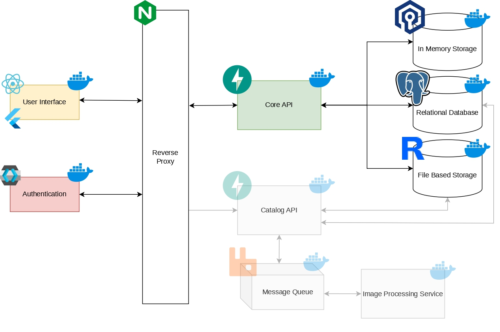
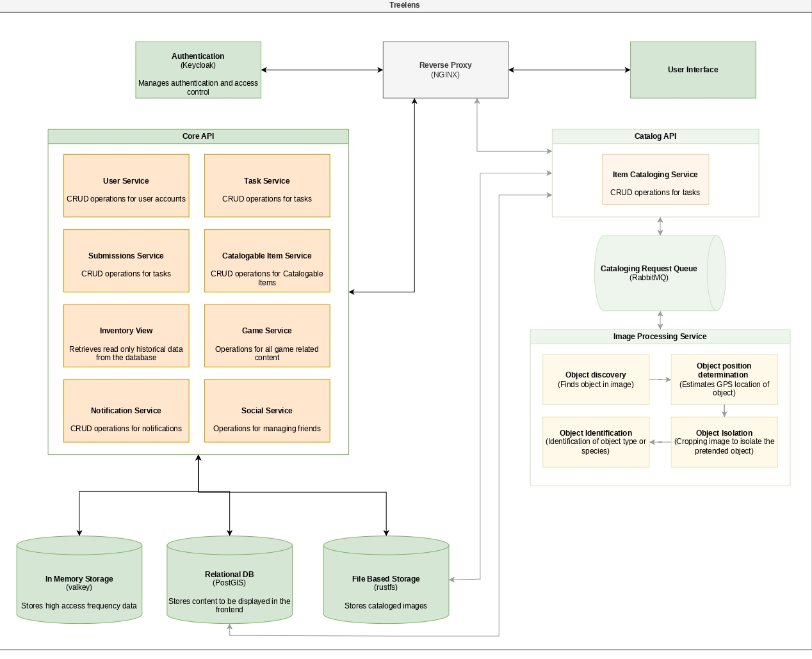

import PresentationViewer from '~/components/PresentationViewer.astro';

<PresentationViewer src="/documentation-website/presentations/ms3.pdf" title="MS3" />

---

## Table of Contents

1. [Gamification of the Tree Enthusiast Flow](#1-gamification-of-the-tree-enthusiast-flow)
    - [Use cases](#11-use-cases)
    - [User stories](#12-user-stories)
    - [Updated system architecture](#13-updated-system-architecture)
    - [ Updated components diagram](#14-updated-components-diagram)
2. [RGPD](#2-rgpd)
    - [Why data protection matters for TreeLens](#21-why-data-protection-matters-for-treelens)
    - [Who is responsible](#22-who-is-responsible)
    - [What we collect and why](#23-what-we-collect-and-why)
    - [Location](#24-location)
    - [Faces and licence plates](#25-faces-and-licence-plates)
    - [Deleting an account without destroying the dataset](#26-deleting-an-account-without-destroying-the-dataset)
    - [Private profiles and the Minimum age](#27-private-profiles-and-the-minimum-age)
    - [User Rights](#28-user-rights)
    - [Security and Retention](#29-security-and-retention)
3. [Licensing](#3-licensing)
    - [The TreeLens License](#31-the-treelens-license)
    - [Third-party software](#32-third-party-software)
    - [Images submitted by users](#33-images-submitted-by-users)
4. [Sector-Specific Regulation](#4-sector-specific-regulation)
    - [The urban tree inventory](#41-the-urban-tree-inventory)
    - [Geographic information standards](#42-geographic-information-standards)
    - [Open data](#43-open-data)
    - [ Artificial intelligence rules](#44-artificial-intelligence-rules)
    - [Rules for platforms hosting user content](#45-rules-for-platforms-hosting-user-content)
5. [Terms and Conditions](#5-tems-and-conditions)
    - [Who it covers and how people accept it](#51-who-it-covers-and-how-people-accept-it)
    - [Using the platform](#52-using-the-platform)
    - [Content that users submit](#53-content-that-users-submit)
    - [Content that users submit](#54-reporting-and-removal)
    - [“As is” and its limits](#55-as-is-and-its-limits)
    - [Price and cancellation](#56-price-and-cancellation)
    - [Changing the terms](#57-changing-the-terms)
    - [Municipal users](#58-municipal-users)
6. [Usability and Digital Accessibility](#6-usability-and-digital-accessibility)
---

## 1. Gamification of the Tree Enthusiast Flow
In Milestone 2, the Tree Enthusiast was a secondary contributor. This user could identify a species from a photo, browse the map and propose trees that a Municipal Technician would later validate. The core of the product was, and remains, the municipal workflow: survey zones, tasks for Field Surveyors, a validation queue, statistics, comparison of surveys and export of the inventory.

Two things changed after that milestone.

The first is a data problem. Since the first week of the project we have been unable to find annotated datasets that match what we need. The ones available are small and look nothing like our pilot sites, and the datasets proposed by the advisors also deviated from our goal. A detection model cannot be trained without labelled images, so in Meeting 5 we decided to set detection aside and build the whole system manually before the MVP, which also leaves room for code integration.

The second is a suggestion. During the Milestone 2 presentation, the instructors proposed gamifying the application. In Meeting 6 we realised this addresses the data problem directly. If ordinary people are motivated to photograph and catalogue trees in their own city, the platform collects, as a side effect, exactly the labelled images that were missing. The goal is therefore to deliver, before the MVP, an application where the average user can upload tree images and catalogue them, building up the dataset. The validation step does not change: a Municipal Technician still accepts or rejects every catalogued entry, as defined in Milestone 2.

Gamification is therefore an addition and not a replacement. Nothing in the municipal side of the project was removed or reduced, and every municipal requirement and use case from Milestone 2 remains valid. The Tree Enthusiast flow simply stops being a side feature and becomes the engine that feeds the review queue.

The mechanics come from the brainstorming in Meeting 6. From Pokémon GO we took the idea of rewarding rarity, so a tree that nobody has registered yet is worth more. From Duolingo we took daily streaks, ranked leagues, reminders and friends. The mascot idea, which reacts when a streak is at risk, supports the same loop. The resulting features are points with bonuses, streaks, leagues and leaderboards, daily reminders, XP zones, a friend network and a personal collection of species (the TreeDex).

### 1.1. Use Cases
* **UC20:** View Own Progress (streak, XP, league, mascot). Actor: Tree Enthusiast
* **UC21:** Configure Daily Reminder. Actor: Tree Enthusiast
* **UC22:** View League Leaderboard. Actor: Tree Enthusiast
* **UC23:** Send Friend Request. Actor: Tree Enthusiast
* **UC24:** Respond to Friend Request. Actor: Tree Enthusiast
* **UC25:** View Friends’ Progress. Actor: Tree Enthusiast
* **UC26:** View XP Zones. Actor: Tree Enthusiast
* **UC27:** View Personal Tree Collection (TreeDex). Actor: Tree Enthusiast

### 1.2. User Stories

#### US33: Points for a submission
> - **As a:** Tree Enthusiast  
> - **I want:** to earn points when I submit a photo of a tree  
> - **So that:** I feel rewarded for contributing

Background  
- Given I am logged in as a Tree Enthusiast

Scenario 01: Points shown as pending after submitting  
- When I submit a photo in which a tree is detected  
- Then I see the points I can earn for that submission  
- And they are marked as pending until a Municipal Technician reviews the submission

Scenario 02: Points confirmed when the submission is approved  
- Given I have a submission with pending points  
- When a Municipal Technician approves the submission  
- Then the points are added to my score

Scenario 03: Points discarded when the submission is rejected  
- Given I have a submission with pending points  
- When a Municipal Technician rejects the submission  
- Then the pending points are discarded  
- And my score does not change

Scenario 04: Photo without a detectable tree earns no points  
- When I submit a photo where no tree is detected  
- Then no points are offered for that submission

#### US34: Bonus points for a new tree
> - **As a:** Tree Enthusiast  
> - **I want:** to earn more points when I add a tree that is not yet in the dataset  
> - **So that:** I am encouraged to find trees that nobody has registered

Background  
- Given I am logged in as a Tree Enthusiast

Scenario 01: New tree earns bonus points  
- Given the photographed tree is not in the inventory  
- When I submit a photo of that tree  
- Then the points offered include a bonus for a new tree

Scenario 02: Known tree earns no bonus  
- Given the photographed tree already exists in the inventory  
- When I submit a photo of that tree  
- Then the points offered do not include the new tree bonus  
- And I still earn the base points for the photo

Scenario 03: Only the earliest submission receives the bonus  
- Given two users submitted photos of the same new tree  
- When a Municipal Technician approves both submissions  
- Then the earliest submission receives the new tree bonus  
- And the later submission receives only the base points

#### US35: Boosted points in an XP zone
> - **As a:** Tree Enthusiast  
> - **I want:** to earn boosted points for photos taken inside an XP zone  
> - **So that:** I am encouraged to photograph the areas the municipality needs most

Background  
- Given I am logged in as a Tree Enthusiast

Scenario 01: Photo inside an active XP zone  
- Given an XP zone with a boost is active  
- When I submit a photo taken inside that zone  
- Then the points offered are multiplied by the boost of the zone

Scenario 02: Photo inside an expired XP zone  
- Given an XP zone whose end date has passed  
- When I submit a photo taken inside that zone  
- Then the points offered have no boost

Scenario 03: Photo outside every XP zone  
- When I submit a photo taken outside every XP zone  
- Then the points offered have no boost

Scenario 04: Boost is decided when the photo is submitted  
- Given an XP zone is active when I submit a photo inside it  
- And the zone ends before a Municipal Technician approves the submission  
- When the submission is approved  
- Then the boosted points are added to my score

#### US36: Daily streak
> - **As a:** Tree Enthusiast  
> - **I want:** to build a streak of consecutive days with a photo of a tree  
> - **So that:** I am motivated to contribute every day

Background  
- Given I am logged in as a Tree Enthusiast

Scenario 01: First photo of the day extends the streak  
- Given I submitted a valid photo yesterday  
- When I submit a photo in which a tree is detected today  
- Then my streak increases by one day

Scenario 02: Several photos in the same day count once  
- Given my streak has already increased today  
- When I submit another photo in which a tree is detected today  
- Then my streak does not change

Scenario 03: Missing a day resets the streak  
- Given my last valid photo was submitted two days ago  
- When I open the application today  
- Then my streak is shown as 0 days

Scenario 04: Starting a new streak  
- Given my streak is 0 days  
- When I submit a photo in which a tree is detected  
- Then my streak is 1 day

Scenario 05: Photo without a detectable tree does not count  
- When I submit a photo where no tree is detected  
- Then my streak does not change

#### US37: My progress
> - **As a:** Tree Enthusiast  
> - **I want:** to see my progress  
> - **So that:** I know how I am doing

Background  
- Given I am logged in as a Tree Enthusiast

Scenario 01: View my progress  
- When I open my profile  
- Then I see my score, my current streak and my league

Scenario 02: Pending points are shown separately  
- Given I have submissions with pending points  
- When I open my profile  
- Then my confirmed score and my pending points are shown separately

Scenario 03: New user  
- Given I have not submitted any photo  
- When I open my profile  
- Then my score is 0 and my streak is 0 days  
- And I am in the league that starts at 0 points

#### US38: Daily reminder
> - **As a:** Tree Enthusiast  
> - **I want:** to be reminded every day if I have not photographed a tree yet  
> - **So that:** I do not lose my streak

Background  
- Given I am logged in as a Tree Enthusiast

Scenario 01: Reminder when no photo was submitted today  
- Given I have not submitted a valid photo today  
- When my reminder time arrives  
- Then I receive a notification asking me to photograph a tree

Scenario 02: No reminder when I already submitted today  
- Given I have already submitted a valid photo today  
- When my reminder time arrives  
- Then I do not receive a notification

Scenario 03: Reminder mentions the streak at risk  
- Given my streak is 5 days and I have not submitted a valid photo today  
- When my reminder time arrives  
- Then the notification tells me that I will lose a 5-day streak

Scenario 04: Reminders turned off  
- Given I have turned off my daily reminder  
- When my reminder time arrives  
- Then I do not receive a notification

#### US39: Reminder settings
> - **As a:** Tree Enthusiast  
> - **I want:** to configure my daily reminder  
> - **So that:** it reaches me at a time that suits me

Background  
- Given I am logged in as a Tree Enthusiast  
- And I am on the notification settings page

Scenario 01: Choose the reminder time  
- When I set the reminder time to 19:00  
- Then I receive my daily reminder at 19:00

Scenario 02: Turn off the reminder  
- When I turn off the daily reminder  
- Then I stop receiving daily reminders

Scenario 03: Turn the reminder on again  
- Given the daily reminder is turned off  
- When I turn it on  
- Then I receive the daily reminder at the time I had set

#### US40: Submission review notification
> - **As a:** Tree Enthusiast  
> - **I want:** to be notified when a submission of mine is approved or rejected  
> - **So that:** I know the result without opening the application

Background  
- Given I am logged in as a Tree Enthusiast

Scenario 01: Submission approved  
- Given I have a pending submission  
- When a Municipal Technician approves it  
- Then I receive an email saying it was approved  
- And the email shows the points I earned

Scenario 02: Submission rejected  
- Given I have a pending submission  
- When a Municipal Technician rejects it with a reason  
- Then I receive an email saying it was rejected  
- And the email shows the reason

#### US41: Leagues
> - **As a:** Tree Enthusiast  
> - **I want:** to belong to a league that matches my score  
> - **So that:** I have goals to reach

Background  
- Given I am logged in as a Tree Enthusiast  
- And the leagues Bronze from 0 points, Silver from 100 points and Gold from 500 points

Scenario Outline: League according to the score  
- Given my score is \<score>  
- When I open my profile  
- Then my league is \<league>

Scenario: Promotion to a higher league  
- Given my score is 95 and I am in the Bronze league  
- When an approved submission takes my score to 105  
- Then I move to the Silver league  
- And I am notified of the promotion

#### US42: League leaderboard
> - **As a:** Tree Enthusiast  
> - **I want:** to see the leaderboard of my league  
> - **So that:** I can compare myself with other players

Background  
- Given I am logged in as a Tree Enthusiast

Scenario 01: View the leaderboard  
- When I open the leaderboard  
- Then I see the users of my league ordered by score, from highest to lowest

Scenario 02: My position is highlighted  
- When I open the leaderboard  
- Then my own entry is highlighted

Scenario 03: Only public information is shown  
- When I open the leaderboard  
- Then each entry shows only the display name and the score  
- And no e-mail address or username is shown

Scenario 04: League with a single user  
- Given I am the only user in my league  
- When I open the leaderboard  
- Then I see only my own entry

#### US43: Friend request
> - **As a:** Tree Enthusiast  
> - **I want:** to send a friend request to another user  
> - **So that:** we can follow each other’s progress

Background  
- Given I am logged in as a Tree Enthusiast

Scenario 01: Send a friend request  
- Given another user exists with a certain username  
- When I send them a friend request using that username  
- Then the request is pending  
- And that user can see it

Scenario 02: Username not found  
- When I send a friend request to a username that does not exist  
- Then the request is not sent  
- And the system informs me that no user was found

Scenario 03: Already friends  
- Given I am already friends with a certain user  
- When I try to send them a friend request  
- Then the request is not sent  
- And the system informs me that we are already friends

Scenario 04: Request already pending  
- Given I have already sent a friend request to a certain user  
- When I try to send them another one  
- Then the request is not sent  
- And the system informs me that a request is already pending

Scenario 05: Request to myself  
- When I try to send a friend request to my own username  
- Then the request is not sent

#### US44: Friend request response
> - **As a:** Tree Enthusiast  
> - **I want:** to respond to a friend request  
> - **So that:** I choose who follows my progress

Background  
- Given I am logged in as a Tree Enthusiast

Scenario 01: List pending requests  
- Given other users have sent me friend requests  
- When I open my friend requests  
- Then I see each request with the display name of the sender and the date

Scenario 02: Accept a request  
- Given I have a pending friend request  
- When I accept it  
- Then the sender and I become friends

Scenario 03: Decline a request  
- Given I have a pending friend request  
- When I decline it  
- Then we do not become friends  
- And the request is removed

Scenario 04: No pending requests  
- Given I have no pending friend requests  
- When I open my friend requests  
- Then the system informs me that there are no requests

#### US45: Friends’ progress
> - **As a:** Tree Enthusiast  
> - **I want:** to see the progress of my friends  
> - **So that:** I stay motivated by comparing myself with them

Background  
- Given I am logged in as a Tree Enthusiast

Scenario 01: View my friends’ progress  
- Given I have friends  
- When I open my friends list  
- Then each friend shows their display name, score and streak

Scenario 02: Friends ordered by score  
- Given I have several friends  
- When I open my friends list  
- Then they are ordered by score, from highest to lowest

Scenario 03: No friends yet  
- Given I have no friends  
- When I open my friends list  
- Then the system informs me that I have no friends  
- And suggests that I send a friend request

#### US46: XP zones on the map
> - **As a:** Tree Enthusiast  
> - **I want:** to see the XP zones on the map  
> - **So that:** I know where photos earn boosted points

Background  
- Given I am logged in as a Tree Enthusiast  
- And I am on the tree map

Scenario 01: Active XP zones are shown  
- Given there are active XP zones  
- When I open the XP zones layer  
- Then each active zone is outlined on the map  
- And it shows its boost and its end date

Scenario 02: Inactive XP zones are not shown  
- Given there are XP zones that have expired or have not started yet  
- When I open the XP zones layer  
- Then those zones are not shown on the map

Scenario 03: No active XP zones  
- Given there are no active XP zones  
- When I open the XP zones layer  
- Then the system informs me that there are no active zones

### 1.3. Updated system architecture

The architecture defined for Milestone 2 stays the same, with one addition: an in-memory store based on Valkey, which holds the data that gamification reads and writes most often, namely streaks, points and leaderboards. This keeps that traffic away from the PostgreSQL/PostGIS database, which stays focused on the tree inventory. Valkey was chosen over Redis because of Redis’s licence changes (see the licensing section). The detection pipeline, shown faded in the diagram, is scheduled for a later stage.

### 1.4. Updated components diagram

The gamification components were added to the Core API: the Game Service (points, streaks, leagues, leaderboards and XP zones), the Social Service (friends) and the Notification Service (reminders and review results). The Game Service and the Social Service work with the Valkey store. The remaining components are unchanged.

---

## 2. RGPD
### 2.1. Why data protection matters for TreeLens
TreeLens helps build and maintain an inventory of urban trees. To do that, it asks people to upload photos and videos, usually taken on the street, and attaches a location to each one. It also lets people create accounts, collect points and streaks, and connect with friends. That means the platform handles information about identifiable people, and it can accidentally capture information about people who never signed up, such as passers-by and the licence plates of parked cars.

European data-protection regulation sets the rules for this. Its core ideas are simple. Collect only what you need and say why. Have a valid reason for each use of the data. Protect it properly. Let people see, correct and delete their data. Be transparent about what happens to it. TreeLens is set to follow these ideas from the design stage.

### 2.2 Who is responsible
The regulation distinguishes the controller, who decides why and how data is processed, from processors, who handle data on the controller’s behalf. For TreeLens, the controller is the development team, because the team defines every purpose and every technical means: accounts, submissions, gamification, the inventory and the training of the detection model.

The platform will be hosted on infrastructure provided by IEETA, which acts as a processor storing the data on the team’s behalf. Push notifications are delivered through Google’s and Apple’s notification services, which are also processors. Since the team is the controller and is not a public authority acting in an official capacity, a formal Data Protection Officer is not required at this stage. Instead, the team designates a privacy contact who answers questions and requests. If who operates the platform changes in the future, this section should be reviewed.

### 2.3. What we collect and why
Every item has a concrete purpose, and anything unnecessary is simply not collected. The regulation also requires each use of data to rest on a valid justification. For TreeLens there are three them being most processing is needed to provide the service the user signed up for, some is justified by a legitimate interest of the project that does not override the user’s rights, such as security logs and model training, also a small part needs the user’s consent, such as push notifications.

* **Account data.** The email address identifies the account in Keycloak, our identity provider, and supports login and password recovery. The display name appears on leaderboards, friend lists and validation history. It can be a pseudonym, so nobody has to expose their real name. The password is never stored in readable form, only as a strong hash.

* **Photos, videos and metadata.** These are the core of the service. They produce tree detections, populate tree records and, through the gamified layer, build the annotated dataset that the project lacked. Technical metadata embedded in files, such as capture time and device model, is used to date and validate each observation. Whatever is not needed after processing, such as device serial numbers, is removed.

* **Gamification and social data.** Points, streaks, leagues, XP and the TreeDex collection exist because the user chose to take part in the game. The friend list exists only if the user uses it. Both are deleted when the account is deleted.

* **Notification tokens.** These are stored only for users who switch notifications on. They are covered by consent, given through the operating-system prompt, and can be withdrawn at any time. Notification text never includes anything sensitive. A message such as “Your submission was approved” is acceptable. Coordinates are not.

* **Municipal users.** Technicians, surveyors and administrators have their tasks, assigned zones and validation actions recorded, so that it is always possible to tell who changed the official inventory.

* **Security logs.** Access logs (IP address, time, request) are kept. They are essential to detect attacks, which are sometimes discovered weeks after they happen, and to investigate incidents.

### 2.4. Location
Location is some sensitive information the app touches, so its use is tightly limited. The app reads the device’s GPS only at the moment a photo or video is submitted, to estimate where the tree is. It never tracks users in the background.

Users can also place the tree manually on a map, which is useful when a photo has no GPS data, when the user has not granted location permission, or when the GPS signal is poor. This is the most privacy-friendly route, since it needs no location permission, and only the position of the tree is stored, never the position of the user. Each manual location is labelled as such and stays “unconfirmed” until a Municipal Technician validates it, for example by comparing it with other submissions or by sending a surveyor to check. This protects the quality of the inventory, because an official record needs a trustworthy position. It also ties into the game: points stay pending until approval, and deliberately entering a false location is treated as cheating.

### 2.5. Faces and licence plates
Street photos regularly capture people and number plates. TreeLens has no use for that information, so the safest approach is to make sure it never persists. The target design is an automated step in the processing pipeline: a model finds faces and plates, blurs them irreversibly, and only the blurred version is stored. The original is deleted as soon as processing ends, or after the automatic retries if processing fails.

Which model will do the blurring has not been decided yet. The team is studying several possibilities, and a more definite choice is planned for future milestones. The choice also depends on licensing.

In the meantime, the MVP uses a simpler safeguard suggested by the advisors: a pending-review queue that only accepts submissions in which a human reviewer confirms there are no faces or plates. This guarantees the integrity of what enters the system without waiting for the automation, which can be introduced later. Automatic blurring is expected to be best-effort rather than perfect, so every tree record has a “Report image” button. A reported image is hidden until a technician reviews it.

### 2.6. Deleting an account without destroying the dataset
Users have the right to ask for their data to be deleted, including their photos. At the same time, the project depends on a stable dataset and inventory, and training data cannot vanish whenever someone leaves. The reconciling idea is that a photo stops being personal data once it can no longer be traced back to a person.

So when a user deletes an account, TreeLens unlinks the photos instead of erasing them. It removes the user identifier and any leftover metadata, and deletes the profile, points, streak, league, collection and friendships. What remains is a blurred picture of a tree with no connection to anyone. The photo stays in the inventory and dataset, the already trained model does not need retraining, and the person’s data is truly gone. This only works because blurring happens before the image enters the dataset, which is why that step is so important. 

### 2.7. Private profiles and the Minimum age
Younger children need special care, because the rules make it hard to process their data without a parent’s consent, and TreeLens does not run a parental-consent process. Many users, of any age, simply do not want their activity visible to the community. The team’s answer is the private profile.

At registration every user actively chooses between a public and a private profile, with no preselected option, so a profile is only ever public by the user’s own decision. A user with a private profile can still submit photos, and those submissions go through the same processing pipeline, but they are not integrated into the public dataset and are not visible to other users on the community map. A public profile, in return, lets the user see information from other public users.

This also gives a way to serve people below the age where independent sign-up is normally allowed, since their information stays out of public view. 

### 2.8. User Rights
Users can see, correct, export and delete their data directly in the app, in a “My data” section, and the privacy policy is available at registration and at any time afterwards. Requests made to the privacy contact are answered within a short period of time. Users can hide their images from the public map, object to their still-linked data being used for training (in which case the images are unlinked first), export their profile and history as a file, and withdraw consent for notifications. 

### 2.9. Security and Retention
Traffic is encrypted end to end, and the server disk and file storage are encrypted. Passwords are hashed with a strong algorithm by Keycloak. Access is role-based, and each role sees only what it needs. The API is protected against the usual web attacks, such as SQL injection, cross-site scripting and request forgery. Internal services, including the database, Valkey, the message broker and the file store, are not reachable from the internet, and only the reverse proxy is exposed. Changes to official records are audited. Backups are encrypted and kept for at most 30 days. If a data breach occurs, the authority must be notified within 72 hours, and affected users too when the risk is high.

For retention: unblurred originals live only until processing ends. Blurred images are kept indefinitely, since they are part of the inventory, and become anonymous when the author’s data is erased. Deleted accounts are removed within 30 days. Accounts inactive for 24 months get a 30-day warning in the app and are then anonymised. Notification tokens last until notifications are disabled or the account is deleted.

---

## 3. Licensing
### 3.1. The TreeLens License
TreeLens code is proprietary and closed (“all rights reserved”). Since it is developed within the PEI course at the University of Aveiro, rights belong to the University together with the authors under its intellectual-property rules, so any future commercial use will require an agreement with the University’s technology-transfer unit. The exact terms and the split of ownership are still to be confirmed.

### 3.2. Third-party software
TreeLens is built as a set of containers, each doing one job, and the architecture diagram is the best map for reviewing licences. Each block is a separate piece of third-party software, so each needs its own check. The rule we apply to every block is the same: it must not force the project to publish its own code. Everything below runs in Docker containers, and the Docker engine itself is open source under a permissive licence.

* **Entry point and security:** NGINX is the reverse proxy and the only component exposed to the internet. It sits in front of everything else, handles encryption and limits traffic. It is under the BSD-2-Clause licence, which is permissive: we only need to keep its copyright notice. Keycloak handles authentication and roles. It is under Apache-2.0, also permissive, and it includes an explicit patent grant, which gives extra reassurance for use in a closed product.

* **User interface:** The interface has two forms. The community-facing mobile app is written in Flutter, whose SDK is under the BSD-3-Clause licence, as are the routing packages we use. The web interface uses React, which is MIT-licensed, together with its usual ecosystem. The state-management package for Flutter (provider) and the icon set are also MIT. All of these are permissive and compatible with closed software.

* **Core API:** The Core API is written in Python with FastAPI. FastAPI, Pydantic, SQLAlchemy, Alembic and the other libraries around it are under MIT, BSD or Apache licences, so there is nothing to worry about. The one dependency that needs a condition is psycopg2, the driver that connects the API to PostgreSQL. It is under the LGPL, a weak copyleft licence. Using it as a normal, unmodified dependency is fine. If we ever modified the driver itself, we would have to publish those changes to the driver, but never the rest of our code.

* **Data storage:**
    - **Relational database:** PostgreSQL with PostGIS. PostgreSQL has its own very permissive licence. PostGIS, the extension that gives us geographic data types and queries, is under the GPL. That sounds alarming, because the GPL can force code to be opened, but it does not here. PostGIS runs as a separate service inside its own container, and our API only talks to it by sending SQL queries over the network. We never copy its code into ours or link our program to it. The obligation to share source code would only arise if we modified PostGIS and distributed that modified version, which we do not plan to do.

    - **In-memory storage:** Valkey. This store holds fast, temporary data such as cache. We chose Valkey instead of Redis. Recent Redis versions moved to licences that restrict some commercial uses, and the newest ones offer a network-copyleft option. Using Redis internally would probably be allowed, but we preferred to remove the doubt altogether. Valkey is a community fork of Redis under the permissive BSD-3-Clause licence, and it is a drop-in replacement, so the choice costs us nothing technically.

    - **File-based storage:** RustFS. This is where photos and videos are kept. RustFS is under Apache-2.0, which is permissive and compatible. Storing user images in it does not transfer any licence obligations from the software to the images, since those are governed by the image licence described in section 2.5.

* **Components planned for a later stage:** The Catalog API, the message queue and the image processing service are planned for a later phase. The Catalog API uses the same Python stack as the Core API, so the same conclusions apply. The message queue is RabbitMQ, under MPL-2.0. This is a weak copyleft licence that works at file level: it would only require us to share modifications to RabbitMQ’s own files, and we do not modify them. The image processing service will host the tree detection model, YOLOx, and the face and plate blurring model, which has not been chosen yet. It will also use common libraries such as PyTorch (BSD) and OpenCV (Apache-2.0). 

* **Documentation site and External services:** The documentation website is built on an MIT-licensed template together with Astro and Tailwind. It only requires keeping the original copyright notice. The project report is written in LaTeX. LaTeX is distributed under the LaTeX Project Public License, a free licence that lets anyone use, distribute and even modify it, provided that a modified version is renamed so it is not confused with the official one. We only use LaTeX as a tool to write the report, and we neither modify nor redistribute it, so this condition never applies to us. Firebase push notifications are free to use but must be mentioned in the privacy policy. Apple’s notification service requires a paid developer account to publish on the App Store.

### 3.3. Images submitted by users
Users keep the copyright on their photos and videos. By submitting, they give TreeLens a non-exclusive, free, worldwide, irrevocable licence valid for the duration of the copyright. The licence allows storing, processing, displaying on tree records and the map, including in the inventory, and using the images to train and evaluate AI models.

Users can hide their images from the public map, but the images stay in the database. Users guarantee the image is theirs and that it does not infringe anyone’s rights. The licence covers copyright only: personal data is handled by the data-protection rules, which is why deleting an account unlinks the image instead of erasing it. Confirmed illegal content is always removed, regardless of the licence.

---

## 4. Sector-Specific Regulation
TreeLens sits where three regulated areas meet: how cities manage their trees, how geographic information is shared, and how online platforms that host user content and use AI must behave.

### 4.1. The urban tree inventory
The inventory is georeferenced and kept up to date through surveys and contributions. Every tree has a position, and a manually chosen location is confirmed by a technician before it becomes official. Species and position are already part of the tree record, and size and visible signs of poor condition belong to the characterisation extension. Because the rules expect these fields, the team proposes making them mandatory in the record, filled in by a technician until the model can estimate them. Periodic review is supported by comparing surveys. Reliable records without duplicates are supported by automatic deduplication and manual merge and split. Citizen participation is answered directly by the community layer, since gamification turns ordinary people into contributors. 

The most important design principle is that TreeLens is a support tool, not a decision-maker. Nothing enters the official inventory without a Municipal Technician approving it, so a human is always responsible. TreeLens never decides to fell or prune, and signs of poor condition are shown only as provisional hints for professional assessment.

### 4.2. Geographic information standards
European rules push public geographic data towards common standards, so that it can be combined across systems. In practice this means consistent coordinate systems, metadata and formats. TreeLens stores coordinates in the global WGS84 system and can export in the official Portuguese national system. Exports use open formats (GeoJSON, GeoPackage, CSV with coordinates) readable by common GIS tools, and carry metadata: survey date, how the position was obtained (device GPS or confirmed manual choice) and its estimated precision. This makes the data reusable and honest about its own quality.

### 4.3. Open data
European open-data rules treat geographic and environmental data as especially valuable and encourage publishing it freely. Since TreeLens exports contain no personal data, because the author of a submission is never part of the exported record, they can be published openly without extra anonymisation. This is a direct result of separating tree data from user data in the design.

### 4.4. Artificial intelligence rules
European AI rules sort systems by risk, with strict obligations for high-risk ones, such as those that make decisions about people, and bans on a few practices. TreeLens falls in the lowest-risk category. Detecting trees and species decides nothing about people. The face and plate detector is also low risk, because it detects in order to erase, never to identify. Identification would mean comparing a face against a database of known people, and TreeLens keeps no such database and does no comparison. The transparency duty for systems that interact directly with people, such as chatbots, does not apply either.

The team still adopts good practices voluntarily. The app says that identification is made by AI and is provisional until validated. A human supervises every entry into the official inventory. Model quality metrics (precision, recall and localisation error) are recorded.

### 4.5. Rules for platforms hosting user content
Because TreeLens stores user photos and shows them to others, it counts as a hosting service. European platform rules give such services a safe harbour: they are not liable for illegal content they did not know about, provided they act quickly once informed. In return, they must offer an easy way to report content, tell the people involved what was decided and why, publish clear terms including how moderation works, and provide a contact point. TreeLens meets these through the “Report image” button, which hides content until review, through in-app notifications of decisions with reasons, and through its terms. 

---

## 5. Tems and Conditions
### 5.1. Who it covers and how people accept it
The provider is the TreeLens team. The terms apply to citizens and to municipal users such as surveyors, technicians and administrators. Users accept the terms and the privacy policy at registration through a checkbox that is not pre-ticked. The text must be easy to read: at least size 11 and 1.15 line spacing, on screen as well.

The reason is that rules on standard contracts treat any terms written once and offered to everyone as a special case. They must be communicated clearly and in advance, and any clause that is hidden, hard to read or surprising can be declared void. Making terms readable and requiring an active acceptance is how we can prove users really knew them.

### 5.2. Using the platform
An account needs the user to follow the privacy options described in the data-protection document, giving truthful data, one account per person, and keeping their password safe. At registration users actively choose between a public and a private profile, and can change it later.

Users may submit photos and videos of trees they took themselves, with device GPS or with a location chosen on the map. A manual location stays “unconfirmed” until a technician validates it, and only then does it enter the official inventory and earn points. Users may also browse the inventory, tree records and map, take part in the game (points, streaks, leagues, XP zones, TreeDex) and connect with friends.

Forbidden behaviour starts with cheating in the game: faking GPS, deliberately choosing a false map location, AI generated images and using multiple accounts or automation to collect points. Also forbidden are illegal, offensive or rights-violating content, deliberately including identifiable people, trying to bypass blurring, accessing other users’ data, attacking the platform, offensive or impersonating display names, and scraping data without permission.

If rules are broken, the response is proportionate: removing content, cancelling points, suspending or deleting the account. The user is told the decision and the reason, and can contest it through the contact point. The rules exist because a game gives people a reason to cheat, and without clear terms there would be no basis to cancel points or suspend accounts. Fake photos also damage the inventory and the quality of model training.

### 5.3. Content that users submit
Users keep the copyright on what they upload, and grant TreeLens a non-exclusive, free, worldwide, irrevocable licence for the duration of the copyright, to store, process, display, include in the inventory and use for training AI models. 

Content is not removed from the database or training set at the user’s request, but it can be hidden from the public map. When an account is deleted, the images are unlinked from the person and become anonymous. The user is solely responsible for what they upload, guarantees they are the author, and agrees to compensate TreeLens for losses caused by content that breaks the terms.

The reason behind this is stability. The inventory and the dataset only have value if they are stable, and if every user could withdraw images at any moment, the inventory would lose history and the model would lose data. The responsibility clause moves the risk of content to the person who alone controls it. It protects TreeLens towards the user, not towards third parties or authorities, which is why the reporting process below exists.

### 5.4. Reporting and removal
Every tree record has a “Report image” button, for example for a visible face or plate, illegal content, or an image that is not the uploader’s. A reported image is hidden until a technician reviews it. Confirmed illegal content is always removed, even though the licence exists. Both the reporter and the uploader are told the decision and its reason in the app. The terms explain that moderation combines automatic steps (blurring, duplicate detection, detecting images without trees) with human review.

The reason is that platform rules protect a hosting service from liability for user content only if it acts diligently once it learns about illegal material. They also require an accessible reporting mechanism, reasons for decisions, and an honest description of how moderation works, including automated decisions.

### 5.5. “As is” and its limits
The service is provided “as is” and “as available”, without guarantees of uninterrupted or error-free operation. AI identification of species, locations and condition is an automatic estimate, provisional until a human validates it, and should not be the only basis for decisions such as felling or pruning. Automatic blurring is best-effort and may fail, and the team corrects failures as soon as it learns of them. Points, leagues, streaks and collections have no monetary value and can be adjusted or reset, for instance after fixing a bug, dealing with cheating or at the end of a league season, with no right to compensation.

These limits matter. Contract rules do not allow a provider to exclude responsibility for harm to life or health, for deliberate or grossly negligent behaviour, or to shift risks unfairly onto consumers, and a blanket “we are not responsible for anything” clause would simply be void. Therefore, for citizens, the “as is” wording works mainly as an honest warning: the AI can be wrong, blurring can fail and points have no value. It is not a general escape from liability. The wording concentrates on what TreeLens genuinely does not control, which reduces the team’s exposure within what the law allows.

### 5.6. Price and cancellation
The service is free for citizens, with no in-app purchases, so there are no refunds. Users can delete their account at any time in the app. TreeLens may end the service with 30 days’ notice in the app.

### 5.7. Changing the terms
The terms may be changed only for reasons listed in them: a change in the law or an authority’s decision, security or data-protection reasons, new features or changes to the service (such as the game rules), and correction or clarification of the text. Relevant changes are announced in the app 15 days in advance. A user who disagrees can delete the account before they take effect, and continuing to use the service afterwards means accepting the new version. Changes required by law or security can apply immediately. Each version is dated, numbered and kept in an accessible history.

The reason is that rules on standard contracts forbid a provider from changing terms at will, unless valid reasons were agreed in advance. Listing reasons, giving notice and offering an exit give users real knowledge of what they are agreeing to.

### 5.8. Municipal users
Surveyors, technicians and administrators must keep their credentials confidential, use their accounts only for service purposes, and are responsible for the validations and corrections they make. The platform records who did what.

---

## 6. Usability and Digital Accessibility
- TO BE COMPLETED
